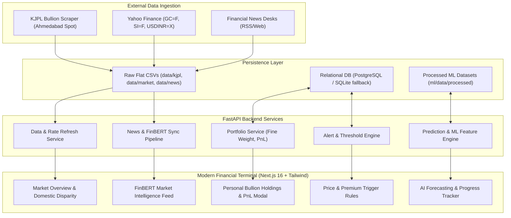

# GoldSense AI (Develop Branch)

**GoldSense AI** is a premium Bullion Intelligence, Personal Portfolio Tracking, and Machine Learning Gold-Price Prediction Platform. It bridges international precious metals markets (COMEX/LBMA via Yahoo Finance) and Indian physical spot bullion rates (KJPL in Ahmedabad, Gujarat) with real-time analytics, automated financial news NLP (FinBERT sentiment), price disparity metrics, and multi-user ready personal physical bullion management.

---

## 🌟 Key Features

### 1. Unified Market Overview & Live Domestic Disparity
- **Indian Physical Bullion (KJPL Ahmedabad)**: Real-time tracking of Gold 999 (24K) and Silver 999 spot prices in INR per gram / kg.
- **Global Benchmark Spot (USD)**: Continuous monitoring of COMEX Gold Futures (`GC=F`), Silver Futures (`SI=F`), and Foreign Exchange (`USDINR=X`).
- **Mathematical Benchmark Conversion**:
  $$\text{Global Gold (INR/g)} = \frac{\text{XAU/USD} \times \text{USD/INR}}{31.1034768}$$
- **Domestic Premium / Disparity Index**:
  $$\text{Premium (\%)} = \frac{\text{KJPL Rate} - \text{Global Rate (INR/g)}}{\text{Global Rate (INR/g)}} \times 100$$
  *Reflects India's Basic Customs Duty (BCD), Agriculture Infrastructure and Development Cess (AIDC), and local landing premiums (typically +5.5% to +7.5%).*
- **Debounced Active Refresh**: User-triggered on-demand refresh with a 60-second server debounce window and explicit freshness indicators (`FRESH` <10m, `DELAYED` <60m, `STALE` >60m).

### 2. Personal Bullion Portfolio Tracking
- **Physical Holdings Management**: Add, update, and manage Gold & Silver holdings (bars, coins, jewelry).
- **Exact Purity & Weight Math**: Supports weight inputs in both **grams** and **kilograms**, automatically standardizing to gross grams and calculating fine gold/silver content based on purity (e.g., 999.9, 995, 916 / 22K, 750 / 18K).
  $$\text{Fine Weight (g)} = \text{Gross Weight (g)} \times \left(\frac{\text{Purity}}{1000}\right)$$
- **Real-Time Valuation & PnL**: Instant evaluation against live physical benchmark rates:
  $$\text{Current Value} = \text{Gross Weight} \times \text{Spot Rate} \times \left(\frac{\text{Purity}}{999}\right)$$
  $$\text{Unrealized PnL} = \text{Current Value} - \text{Total Acquisition Cost}$$
- **Privacy & Multi-User Architecture**: Multi-user isolation built in using persistent `user_id` attributes (via `X-User-ID` session headers), strictly isolating personal portfolio records.
- *Explicit Non-Commercial Scope*: Focuses purely on personal wealth monitoring — zero commercial POS, invoicing, customer CRM, or merchant selling workflows.

### 3. Financial News Intelligence & FinBERT Sentiment
- **Automated Collector**: Continuous RSS ingestion from premium financial desks (Reuters, Bloomberg, CNBC, Financial Express, Economic Times).
- **Domain Relevance Engine**: High-precision keyword filtering (`gold`, `bullion`, `central bank`, `precious metals`, `xauusd`).
- **FinBERT NLP Sentiment**: Pre-trained financial sentiment analysis scoring each article on Bullish / Bearish / Neutral orientation, confidence, and gold impact magnitude.
- **Synchronized Cache**: Full sync between raw news (`data/news/news_articles.csv`) and analyzed cache (`ml/data/processed/analyzed_news.csv`) with automatic backfill.

### 4. Machine Learning Forecasting Engine
- **Target**: Next-event KJPL Gold rate (`next_event_gold`) and anticipated price delta.
- **Zero-Lookahead Alignment**: Forward-looking targets aligned strictly with historical market close, domestic premiums, exchange rate shifts, and pre-event news sentiment windows.
- **Honest Data Governance**: Provides transparent metadata when training observations are under the statistical minimum threshold of 50 samples (`EXPERIMENTAL_DATA_COLLECTION` status for current 34 events).
- **Explainable Metrics**: Baseline Directional Accuracy, RMSE, MAE, and feature importance rankings.

---

## 🏛️ System Architecture



---

## 🚀 Quick Start & Setup

### Prerequisites
- **Python 3.11+**
- **Node.js 18+ & npm**
- **PostgreSQL** (optional; the application gracefully falls back to SQLite `data/goldsense.db` if PostgreSQL is unavailable)

### 1. Clone Repository & Environment Setup
```bash
git clone -b develop https://github.com/Dhruv-vm/GoldSense-AI.git
cd GoldSense-AI
cp backend/.env.example backend/.env
```

### 2. Backend Setup
```bash
cd backend
python -m venv .venv
source .venv/bin/activate
pip install -r requirements.txt

# Run test suite to verify installation
pytest tests/ -v

# Start FastAPI application
uvicorn app.main:app --host 0.0.0.0 --port 8000 --reload
```
The interactive API documentation is available at `http://localhost:8000/docs`.

### 3. Frontend Terminal Setup
```bash
cd ../frontend
npm install
npm run build
npm run dev
```
Open `http://localhost:3000` in your browser.

---

## 📂 Repository Directory Structure

```text
GoldSense-AI/
├── .github/workflows/          # Automated GitHub Actions collectors and CI
│   ├── kjpl_collector.yml      # Scheduled KJPL rate ingestion
│   ├── market_collector.yml    # Scheduled Yahoo Finance market collector
│   └── news_collector.yml      # Scheduled financial news collector
├── backend/
│   ├── app/
│   │   ├── api/routes/         # FastAPI endpoints (kjpl, market, portfolio, alerts, news, prediction)
│   │   ├── db/                 # Database session and SQLite fallback handler
│   │   ├── models/             # SQLAlchemy ORM models (portfolio, alert)
│   │   └── services/           # Business logic (data_service, portfolio_service, alert_service)
│   ├── ml/
│   │   ├── data/processed/     # Analyzed news cache and merged training dataset
│   │   ├── features/           # Feature engineering and zero-lookahead merge pipeline
│   │   ├── models/             # FinBERT sentiment and saved prediction models
│   │   └── training/           # sync_news_analysis.py, train_model.py, evaluate.py
│   └── tests/                  # Pytest integration and unit test suite
├── data/                       # Ground-truth source CSVs
│   ├── kjpl/                   # kjpl_rates.csv
│   ├── market/                 # market_rates.csv
│   └── news/                   # news_articles.csv
├── docs/                       # Complete engineering and product documentation
│   ├── architecture/           # System design, data flow, schema, security
│   ├── data/                   # Data sources, pipelines, conversions, quality
│   ├── development/            # Local setup, environment vars, testing
│   ├── ml/                     # Architecture, features, training, leakage prevention
│   ├── news/                   # News pipeline, relevance, FinBERT sentiment
│   ├── operations/             # Deployment, scheduled workflows, backups
│   ├── portfolio/              # Holdings model, valuation methodology
│   └── product/                # Vision, feature matrix, requirements, roadmap
├── frontend/                   # Next.js 16 (Turbopack) + Tailwind CSS Dashboard
│   ├── app/                    # App Router and main financial terminal UI
│   └── components/             # Reusable UI widgets and charts
├── AGENTS.md                   # Engineering principles and agent instructions
├── CHANGELOG.md                # Detailed release and build audit history
├── CONTRIBUTING.md             # Contributor guidelines and workflow
└── README.md                   # Platform documentation index
```

---

## 🧪 Testing & Validation

Run the complete backend test suite:
```bash
cd backend
source .venv/bin/activate
pytest tests/ -v
```
All **59 unit and integration tests** validate:
- Dynamic conversion math (Troy oz to grams, USD/INR conversion).
- Domestic premium and Indian customs duty parity.
- Portfolio fine weight calculations across 999.9, 995, 916, 750 purities.
- Multi-user portfolio isolation and CRUD constraints.
- Prediction service graceful handling of experimental sample counts (<50).
- Zero-lookahead feature alignment invariants.
- API endpoints for rate overview, debounced refresh, alerts, and news feeds.

---

## 📜 Documentation Index

Detailed engineering guides and architectural specifications are organized in the `docs/` directory:
- [System Architecture](docs/architecture/SYSTEM_ARCHITECTURE.md)
- [Data Flow & Cutoff Rules](docs/architecture/DATA_FLOW.md)
- [Database Schema & Migrations](docs/architecture/DATABASE_SCHEMA.md)
- [Rate Units & Conversion Math](docs/data/RATE_UNITS_AND_CONVERSIONS.md)
- [Personal Bullion Portfolio Model](docs/portfolio/PORTFOLIO_DATA_MODEL.md)
- [FinBERT News Sentiment Pipeline](docs/news/SENTIMENT_ANALYSIS.md)
- [Machine Learning Zero-Leakage Engine](docs/ml/LEAKAGE_PREVENTION.md)
- [Model Limitations & Data Thresholds](docs/ml/MODEL_LIMITATIONS.md)

---

## ⚖️ License
Proprietary / Private personal project with multi-user isolation architecture. Distributed under MIT License for codebase components.
