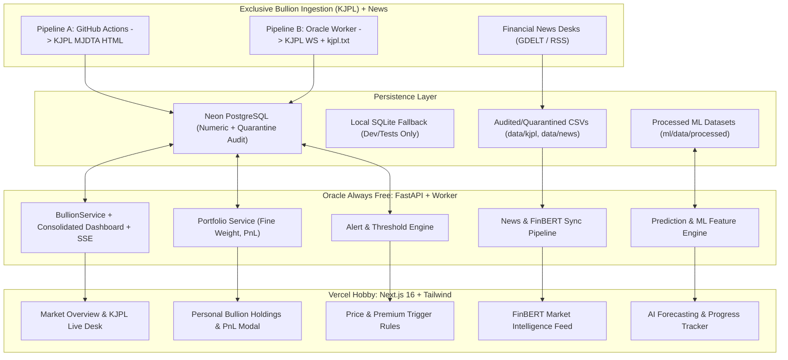

# VMD Bullion (GoldSense AI — Develop Branch)

**VMD Bullion** is a Bloomberg-inspired Indian physical bullion intelligence platform, personal vault tracker, and ML analytics terminal. It surfaces Indian physical bullion rates across five hubs (Chennai, Bengaluru, Mumbai, Coimbatore, Hyderabad), 1KG 99.99 wholesale bars, MJDTA reference prices, LBMA fixes, and global spot parity (`SPOT-GOLD`, `SPOT-SILVER`, `SPOT-INR`) sourced **exclusively from KJPL** — avoiding third-party spot APIs — alongside automated financial news intelligence and multi-user vault management.

---

## 🌟 Key Features

### 1. Unified Market Overview & KJPL Exclusive Parity
- **Indian Physical Bullion (KJPL Live + MJDTA)**: Tracks Chennai, Bengaluru, Mumbai, Coimbatore, and Hyderabad 100g 999 gold rates, `GOLD_1KG_9999`, MJDTA Gold/Silver references, and LBMA AM/PM USD fixes.
- **KJPL Spot & INR Desk (Type 1 & Type 2)**: Direct ingestion of KJPL `SPOT-GOLD`, `SPOT-SILVER`, `SPOT-INR`, and Indian contracts (`GOLDDEC`, `SILVERDEC`). *(Yahoo Finance / `yfinance` is permanently decommissioned per ADR-001.)*
- **Mathematical Benchmark Conversion**:
  $$\text{KJPL Spot Gold (INR/g)} = \frac{\text{SPOT-GOLD (USD/oz)} \times \text{SPOT-INR}}{31.1034768}$$
- **Domestic Premium / Disparity Index**:
  $$\text{Premium (\%)} = \frac{\text{KJPL Rate} - \text{KJPL Spot (INR/g)}}{\text{KJPL Spot (INR/g)}} \times 100$$
- **Real-Time SSE & Explicit Freshness Badges**: Consolidated `/api/bullion/dashboard` + Server-Sent Events (`/api/bullion/stream`) reflecting verified database state (`LIVE`, `FRESH`, `DELAYED`, `STALE`, `MARKET_CLOSED`, `SOURCE_UNAVAILABLE`, `QUARANTINED`).

### 2. Personal Bullion Portfolio Tracking
- **Physical Holdings Management**: Add, update, and manage Gold & Silver holdings (bars, coins, jewelry).
- **Exact Purity & Weight Math**: Supports weight inputs in both **grams** and **kilograms**, automatically standardizing to gross grams and calculating fine gold/silver content based on purity (e.g., 999.9, 995, 916 / 22K, 750 / 18K).
  $$\text{Fine Weight (g)} = \text{Gross Weight (g)} \times \left(\frac{\text{Purity}}{1000}\right)$$
- **Real-Time Valuation & PnL**: Instant evaluation against live physical benchmark rates:
  $$\text{Current Value} = \text{Gross Weight} \times \text{Spot Rate} \times \left(\frac{\text{Purity}}{999}\right)$$
  $$\text{Unrealized PnL} = \text{Current Value} - \text{Total Acquisition Cost}$$
- **Privacy & Multi-User Architecture**: Multi-user isolation built in using persistent `user_id` attributes (via `X-User-ID` session headers), strictly isolating personal portfolio records.
- *Explicit Non-Commercial Scope*: Focuses purely on personal wealth monitoring — zero commercial POS, invoicing, customer CRM, or merchant selling workflows.

### 3. Freshness-First Bullion News Intelligence & Macro Driver Attribution
- **Automated Collector**: Continuous RSS and GDELT 2.0 ingestion with dual persistence:
  - `data/news/live_news.csv`: Dedicated live production dataset containing strictly unexpired, fresh articles (< 72h retention, default 24h lookback). Stale and future-dated articles are pruned on each run.
  - `data/news/news_articles.csv`: Permanent append-only research archive (2,860+ records) preserving historical data for training and backtesting.
- **Domain Relevance Engine**: High-precision multi-driver taxonomy categorizing news across Fed monetary policy, US Dollar FX, safe-haven geopolitics, physical retail demand, central bank accumulation, and market momentum.
- **Commodity Directional Impact Ranking**: Replaces generic financial sentiment with bullion-specific economic transmission logic (e.g., hawkish Fed / strong dollar -> Bearish for gold; rate cuts, safe-haven geopolitics, central bank buying -> Bullish for gold).
- **Syndicated Wire Clustering**: Semantic stem clustering deduplicates wire reprints (Reuters/PTI syndications) to prevent repeated headlines from artificially inflating sentiment scores.
- **Freshness Prioritization & Time-Decay**: Configurable recency windows (24h default, 48h, 72h) with exponential time-decay ($e^{-\Delta t / 12}$) prioritizing immediate market-moving catalysts.
- **Decoupled Macro Consensus & Transparent Endpoints**:
  - `GET /api/news/live-signal?window_hours=24`: Returns net directional consensus (`BULLISH`, `BEARISH`, `MIXED`, `NEUTRAL`), confidence level, driver breakdown, market vs. news alignment, and explicit `INSUFFICIENT_FRESH_RELEVANT_NEWS` guard if fewer than 2 distinct fresh clusters exist.
  - `GET /api/news/latest?window_hours=24&limit=30`: Enriched with bullion impact, macro driver category, confidence, and explanatory evidence rationale for each story.
  - `GET /api/news/archive?limit=50&offset=0`: Historical research archive access.

### 4. Machine Learning Forecasting Engine
- **Target**: Next-event KJPL Gold rate (`next_event_gold`) and anticipated price delta.
- **Zero-Lookahead Alignment**: Forward-looking targets aligned strictly with historical market close, domestic premiums, exchange rate shifts, and pre-event news sentiment windows.
- **Honest Data Governance**: Provides transparent metadata when training observations are under the statistical minimum threshold of 50 samples (`EXPERIMENTAL_DATA_COLLECTION` status for current 34 events).
- **Explainable Metrics**: Baseline Directional Accuracy, RMSE, MAE, and feature importance rankings.

---

## 🏛️ System Architecture



---

## 🚀 Quick Start & Setup

### Prerequisites
- **Python 3.12** (backend venv)
- **Node.js 20+ & npm** (Next.js frontend)
- **Neon PostgreSQL** in `ENVIRONMENT=production` (`DATABASE_URL` with `sslmode=require`, fail-closed); local dev/test environments allow SQLite (`data/goldsense.db`).

### 1. Clone Repository & Environment Setup
```bash
git clone -b develop https://github.com/Dhruv-vm/GoldSense-AI.git
cd GoldSense-AI
cp .env.example .env
```

### 2. Backend Setup
```bash
cd backend
python -m venv .venv
source .venv/bin/activate
pip install -r requirements-api.txt

# Apply migrations & run test suite
alembic upgrade head
PYTHONPATH=backend .venv/bin/pytest tests/ -v

# Start FastAPI application (from repo root or backend/)
uvicorn app.main:app --host 0.0.0.0 --port 8000 --reload
```
The interactive API documentation is available at `http://localhost:8000/docs`.

### 3. Frontend Terminal Setup
```bash
cd ../frontend
npm install
npm run build
npm run dev
```
Open `http://localhost:3000` in your browser.

---

## 📂 Repository Directory Structure

```text
GoldSense-AI/
├── .github/workflows/          # Automated GitHub Actions collectors (no develop git commits)
│   ├── kjpl-collector.yml      # Pipeline A MJDTA ingestion -> NEON_DATABASE_URL
│   ├── market-collector.yml    # Decommissioned Yahoo stub
│   ├── news-collector.yml      # Scheduled financial news collector
│   └── pipeline-update.yml     # Feature engineering & ML evaluation validator
├── deploy/oracle/              # Systemd units & Nginx SSE config for Oracle Always Free
├── backend/
│   ├── requirements-api.txt    # Lean FastAPI + Neon runtime deps
│   ├── requirements-worker.txt # Lean live KJPL worker deps (websockets, psycopg)
│   ├── requirements-ml.txt     # FinBERT / PyTorch / scikit-learn offline ML deps
│   ├── app/
│   │   ├── api/routes/         # FastAPI endpoints (kjpl, market, portfolio, alerts, news, prediction)
│   │   ├── db/                 # Database session and SQLite fallback handler
│   │   ├── models/             # SQLAlchemy ORM models (portfolio, alert)
│   │   └── services/           # Business logic (data_service, portfolio_service, alert_service)
│   ├── ml/
│   │   ├── data/processed/     # Analyzed news cache and merged training dataset
│   │   ├── features/           # Feature engineering and zero-lookahead merge pipeline
│   │   ├── models/             # FinBERT sentiment and saved prediction models
│   │   └── training/           # sync_news_analysis.py, train_model.py, evaluate.py
│   └── tests/                  # Pytest integration and unit test suite
├── data/                       # Ground-truth source CSVs
│   ├── kjpl/                   # kjpl_rates.csv
│   ├── market/                 # market_rates.csv
│   └── news/                   # news_articles.csv
├── docs/                       # Complete engineering and product documentation
│   ├── architecture/           # System design, data flow, schema, security
│   ├── data/                   # Data sources, pipelines, conversions, quality
│   ├── development/            # Local setup, environment vars, testing
│   ├── ml/                     # Architecture, features, training, leakage prevention
│   ├── news/                   # News pipeline, relevance, FinBERT sentiment
│   ├── operations/             # Deployment, scheduled workflows, backups
│   ├── portfolio/              # Holdings model, valuation methodology
│   └── product/                # Vision, feature matrix, requirements, roadmap
├── frontend/                   # Next.js 16 (Turbopack) + Tailwind CSS Dashboard
│   ├── app/                    # App Router and main financial terminal UI
│   └── components/             # Reusable UI widgets and charts
├── AGENTS.md                   # Engineering principles and agent instructions
├── CHANGELOG.md                # Detailed release and build audit history
├── CONTRIBUTING.md             # Contributor guidelines and workflow
└── README.md                   # Platform documentation index
```

---

## 🧪 Testing & Validation

Run the complete backend test suite:
```bash
PYTHONPATH=backend backend/.venv/bin/pytest backend/tests/ -v
```
Tests validate:
- Exclusive KJPL unit normalization, MJDTA/HTML parsing, and Type 1/2/3 live stream extraction.
- Historical corruption quarantine rules and `Decimal`/`Numeric` persistence.
- Neon URL normalization (`sslmode=require`), production fail-closed startup, `/health` 503 degradation, and SSE streaming.
- Multi-user portfolio isolation, auth enforcement, zero-lookahead news/ML invariants, and API endpoints.

---

## 📜 Documentation Index

Detailed engineering guides and architectural specifications are organized in the `docs/` directory:
- [Master Engineering Audit](docs/VMD_BULLION_MASTER_AUDIT.md)
- [ADR-001: KJPL + Oracle + Neon + Vercel](docs/architecture/ADR_001_KJPL_ORACLE_NEON_VERCEL.md)
- [KJPL Data Dictionary](docs/data/KJPL_DATA_DICTIONARY.md)
- [Historical Remediation Report](docs/data/REMEDIATION_REPORT.md)
- [System Architecture](docs/architecture/SYSTEM_ARCHITECTURE.md)
- [Database Schema & Migrations](docs/architecture/DATABASE_SCHEMA.md)
- [Deployment Operations](docs/operations/DEPLOYMENT.md)

---

## ⚖️ License
Proprietary / Private personal project with multi-user isolation architecture. Distributed under MIT License for codebase components.
