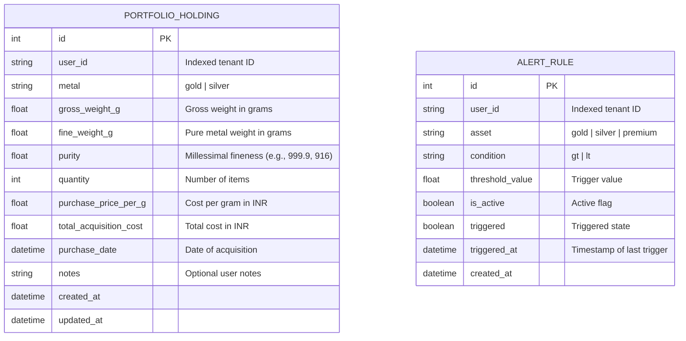

# Database Schema & Entity Relationships

GoldSense AI uses SQLAlchemy for relational mapping, supporting PostgreSQL in containerized/production setups with automatic fallback to SQLite (`data/goldsense.db`) for local developer setups.

---

## 1. Entity Relationship Diagram

---

## 2. Table Specifications

### `portfolio_holdings`
Stores user-owned physical bullion assets (bars, coins, jewelry).

| Column | Type | Constraints | Description |
| :--- | :--- | :--- | :--- |
| `id` | `INTEGER` | `PRIMARY KEY, AUTOINCREMENT` | Unique holding ID |
| `user_id` | `VARCHAR(64)` | `NOT NULL, INDEX` | User ID for multi-tenant isolation |
| `metal` | `VARCHAR(16)` | `NOT NULL` | Metal type (`gold`, `silver`) |
| `gross_weight_g`| `FLOAT` | `NOT NULL` | Gross physical weight in grams |
| `fine_weight_g` | `FLOAT` | `NOT NULL` | Pure metal weight ($\text{gross} \times \text{purity} / 1000$) |
| `purity` | `FLOAT` | `NOT NULL` | Millesimal fineness (e.g. 999.9, 995.0, 916.0, 750.0) |
| `quantity` | `INTEGER` | `DEFAULT 1` | Unit count |
| `purchase_price_per_g` | `FLOAT` | `NULLABLE` | Acquisition cost per gram (INR) |
| `total_acquisition_cost`| `FLOAT` | `NULLABLE` | Total purchase expenditure (INR) |
| `purchase_date`| `DATETIME` | `NULLABLE` | Date acquired |
| `notes` | `TEXT` | `NULLABLE` | User annotations (e.g., "MMTC-PAMP Bar") |
| `created_at` | `DATETIME` | `DEFAULT CURRENT_TIMESTAMP` | Row creation timestamp |
| `updated_at` | `DATETIME` | `ON UPDATE CURRENT_TIMESTAMP` | Row modification timestamp |

### `alert_rules`
Stores user-configured price and premium thresholds.

| Column | Type | Constraints | Description |
| :--- | :--- | :--- | :--- |
| `id` | `INTEGER` | `PRIMARY KEY, AUTOINCREMENT` | Unique alert ID |
| `user_id` | `VARCHAR(64)` | `NOT NULL, INDEX` | User ID for multi-tenant isolation |
| `asset` | `VARCHAR(32)` | `NOT NULL` | Monitored asset (`gold`, `silver`, `premium`) |
| `condition` | `VARCHAR(16)` | `NOT NULL` | Operator (`gt` for $>$, `lt` for $<$) |
| `threshold_value` | `FLOAT` | `NOT NULL` | Trigger threshold (INR or %) |
| `is_active` | `BOOLEAN` | `DEFAULT TRUE` | Whether the alert is actively evaluated |
| `triggered` | `BOOLEAN` | `DEFAULT FALSE` | Set to true upon condition breach |
| `triggered_at` | `DATETIME` | `NULLABLE` | Timestamp when triggered |
| `created_at` | `DATETIME` | `DEFAULT CURRENT_TIMESTAMP` | Alert creation timestamp |
