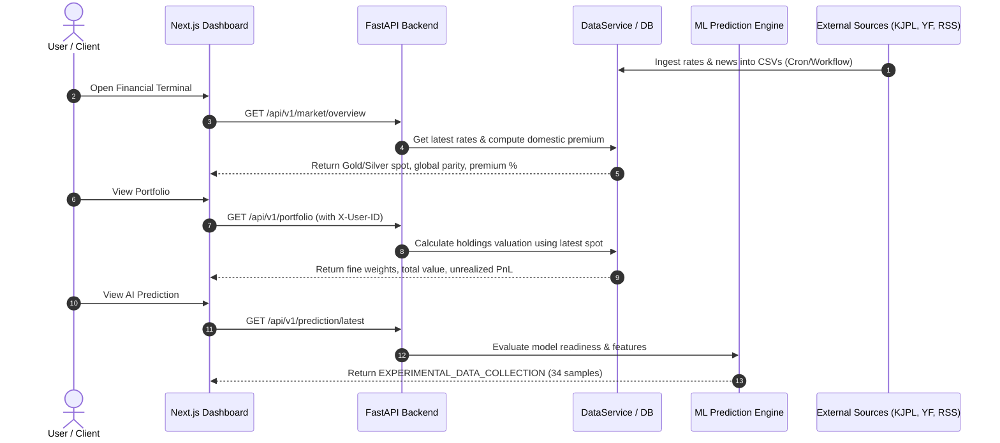

# Data Flow & Point-in-Time Cutoff Rules

## 1. End-to-End Data Lifecycle

---

## 2. Zero-Lookahead Bias & Point-in-Time Discipline

Machine learning in financial markets requires strict point-in-time boundaries to eliminate lookahead bias:

1. **Event Cutoff ($T_{event}$)**:
   - For every KJPL observation at date $T_{event}$, the target is set to the price of the *subsequent* event:
     $$y_{t} = \text{Price}(T_{t+1})$$
   - All feature columns $X_{t}$ must only use market data and news published **on or before** $T_{event}$:
     $$X_{t} \in \mathcal{F}(t \le T_{event})$$

2. **Market Return Windowing**:
   - `xauusd_return_1d`, `usdinr_return_1d`, and `silver_return_1d` are computed based on the previous close relative to $T_{event}$.
   - Intraday high-frequency returns (15-min and 1-hour) are excluded unless continuous high-frequency order books are ingested.

3. **News Sentiment Aggregation**:
   - For event $T_{event}$, only news articles satisfying:
     $$T_{event} - 24\text{ hours} \le t_{\text{published}} \le T_{event}$$
     are included in the sentiment aggregation (`sentiment_score_mean`, `sentiment_score_std`, `news_volume_24h`).
   - Articles published after $T_{event}$ are never used in constructing $X_{t}$.
