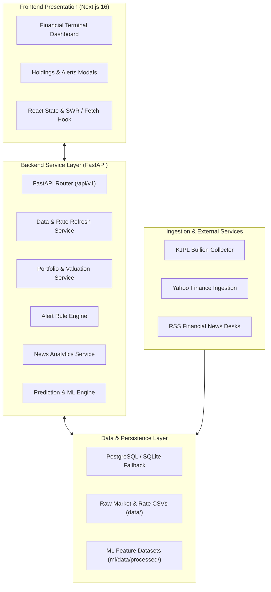

# System Architecture — GoldSense AI

## 1. High-Level Overview
GoldSense AI employs a layered, micro-modular architecture designed for high availability, fast analytical access, and strict personal data privacy.

---

## 2. Component Breakdown

### 2.1 Ingestion Layer (Collectors)
- **KJPL Collector**: Runs on a scheduled workflow, scraping Ahmedabad physical bullion rates and appending records to `data/kjpl/kjpl_rates.csv`.
- **Market Collector**: Fetches COMEX Gold (`GC=F`), COMEX Silver (`SI=F`), and USD/INR exchange rate (`USDINR=X`) via Yahoo Finance, writing to `data/market/market_rates.csv`.
- **News Collector**: Ingests RSS feeds across financial news agencies into `data/news/news_articles.csv`.

### 2.2 Persistence & Storage Layer
- **Raw Flat Files**: Raw observations are stored as immutable, append-only CSV files under `data/`, guaranteeing reproducible replay and auditability.
- **Relational Database**: Manages user-specific portfolio holdings (`portfolio_holdings`) and alert thresholds (`alert_rules`). Uses PostgreSQL in production with automatic fallback to SQLite (`data/goldsense.db`) for lightweight local execution.
- **Processed ML Storage**: Cached FinBERT sentiment analyses and zero-lookahead training matrices stored under `backend/ml/data/processed/`.

### 2.3 Service Layer
- **DataService**: Implements physical conversion math ($31.1034768\text{ g/oz}$), domestic premium formulas, data freshness classification, and a 60-second rate refresh debounce.
- **PortfolioService**: Manages bullion holdings, computes fine gold/silver mass based on Karat/millessimal purity, and marks holdings to market using latest spot prices.
- **AlertService**: Evaluates price thresholds and premium triggers.
- **PredictionService**: Handles feature vector transformation, model inference, and safeguards against low-data inference when sample count $N < 50$.

### 2.4 Presentation Layer
- Built with **Next.js 16 (Turbopack)** and **Tailwind CSS**.
- Institutional dark financial terminal layout with 5 specialized tabs: Overview, Portfolio, Predictions, News Feed, and Alerts.
