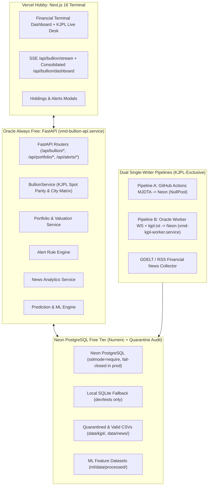

# System Architecture — VMD Bullion (ADR-001)

## 1. High-Level Overview
VMD Bullion employs a layered, single-writer, ₹0/month cloud architecture targeting high data integrity, Decimal monetary precision, and strict personal tenant isolation.

---

## 2. Component Breakdown

### 2.1 Ingestion Layer (Dual Pipelines — KJPL-Exclusive)
- **Pipeline A — Scheduled MJDTA Collector (`scripts/collect_kjpl_csv.py`, `.github/workflows/kjpl-collector.yml`)**: Runs twice-daily IST schedules via GitHub Actions writing directly into Neon PostgreSQL (`NEON_DATABASE_URL`, `DB_USE_NULLPOOL=true`), without automated commits to `develop`.
- **Pipeline B — Live Terminal Worker (`scripts/kjpl_live_worker.py`, `deploy/oracle/vmd-kjpl-worker.service`)**: Runs continuously on Oracle Cloud Always Free under an `fcntl` single-writer lock, consuming `ws://www.kjpl.in/ws` (`SOCKET_TOKEN` subprotocol) and `http://www.kjpl.in/client/kjpl.txt` (`SPOT-GOLD`, `SPOT-SILVER`, `SPOT-INR`, Type 2 Indian contracts, 5-city 100g 999 gold, and `GOLD_1KG_9999`).
- **Decommissioned Yahoo Collector**: `yfinance` / Yahoo Finance (`scripts/collect_market_csv.py`, `.github/workflows/market-collector.yml`) is permanently decommissioned per ADR-001.
- **News Collector**: Ingests GDELT 2.0 and RSS feeds across financial news agencies into `data/news/live_news.csv` and `data/news/news_articles.csv`.

### 2.2 Persistence & Storage Layer
- **Relational Database (Neon PostgreSQL Free Tier)**: Single source of truth in production (`Numeric` columns + quarantine metadata). Startup fails closed when `ENVIRONMENT=production` and `DATABASE_URL` is absent, SQLite, or unreachable. SQLite (`data/goldsense.db`) is used strictly for local development and tests.
- **Audited & Quarantined CSVs**: Corrupt historical CSV rows and oct-31 duplicates are quarantined under `data/kjpl/quarantined_*.csv` (`docs/data/REMEDIATION_REPORT.md`).
- **Processed ML Storage**: Cached FinBERT sentiment analyses and zero-lookahead training matrices stored under `backend/ml/data/processed/`.

### 2.3 Service Layer
- **DataService**: Implements physical conversion math ($31.1034768\text{ g/oz}$), domestic premium formulas, data freshness classification, and a 60-second rate refresh debounce.
- **PortfolioService**: Manages bullion holdings, computes fine gold/silver mass based on Karat/millessimal purity, and marks holdings to market using latest spot prices.
- **AlertService**: Evaluates price thresholds and premium triggers.
- **PredictionService**: Handles feature vector transformation, model inference, and safeguards against low-data inference when sample count $N < 50$.

### 2.4 Presentation Layer
- Built with **Next.js 16 (Turbopack)** and **Tailwind CSS**.
- Institutional dark financial terminal layout with 5 specialized tabs: Overview, Portfolio, Predictions, News Feed, and Alerts.
