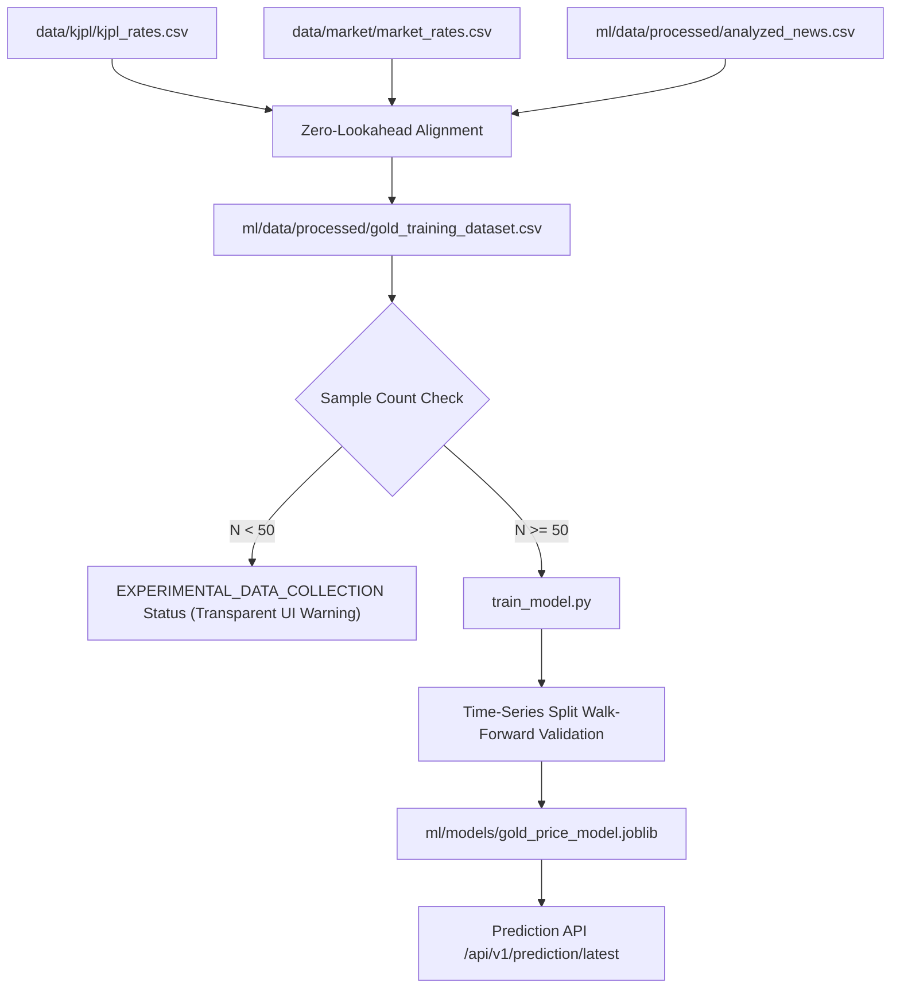

# Machine Learning Architecture

## 1. Objective & Formulation
The prediction engine forecasts the price level and direction of the next KJPL physical gold rate event ($T_{t+1}$) given market state, domestic premium, and news sentiment at event $T_t$.

$$\hat{y}_{t+1} = f(X_t; \Theta)$$

Where:
- $X_t$: Feature vector observed at or prior to $T_t$.
- $y_{t+1}$: The actual gold rate at the next trading event $T_{t+1}$ (`next_event_gold`).
- $f$: Supervised learning regressor (Random Forest Regressor / Gradient Boosting).

---

## 2. ML System Diagram

