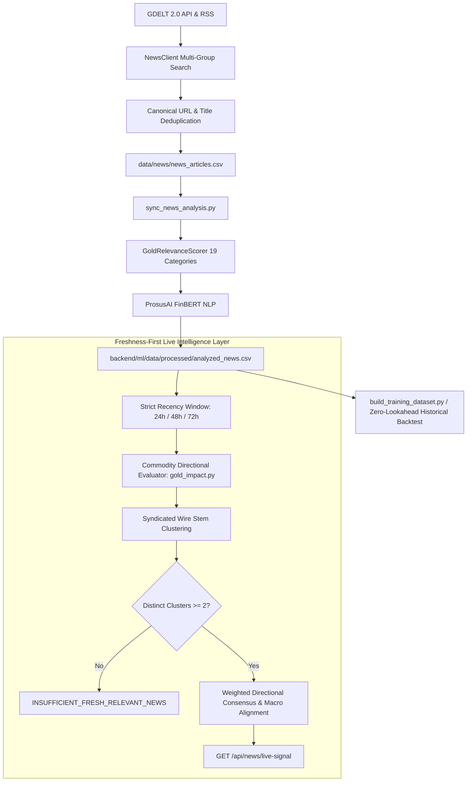

# Financial News Ingestion Pipeline

## 1. Architectural Flow

---

## 2. Ingestion & Provenance

1. **Ingestion Sources**:
   - Primary: **GDELT 2.0 Doc API** (`api.gdeltproject.org`) querying 11 macroeconomic and bullion keyword groups.
   - Fallback: **Google News RSS** with localized Indian financial and bullion coverage if GDELT encounters HTTP 429 throttling.
2. **Corpus Provenance**:
   - Initial Seed Articles: Rows 0–22 (`2026-09-18` to `2026-09-29`), created during repository scaffolding with static canonical URLs.
   - Live Collected Articles: Rows 23–2,814+, genuinely collected by scheduled automated workflows (`.github/workflows/news-collector.yml`).
3. **Canonical Deduplication**:
   - URL Normalization: Strips marketing tracking parameters (`utm_*`, `oc`, `ref`, `src`, `fbclid`, `gclid`) and trailing slashes.
   - Title Normalization: Strips publisher suffixes (` - Reuters`, ` | Bloomberg`), punctuation, and repeated whitespaces.
   - Result: **0 duplicate URLs and 0 duplicate titles** across all corpus records.
4. **Relevance Tagging**: Classifies whether the article is relevant to precious metals, gold, central banks, or monetary policy (currently 40.0% relevant, 60.0% noise).
5. **Domain-Specific Bullion Direction Mapping**: Evaluates commodity-specific economic transmission channels (hawkish Fed / strong USD -> Bearish for gold; dovish pauses, safe-haven geopolitics, central bank buying -> Bullish for gold).
6. **Syndicated Wire Clustering**: Groups wire agency republications (e.g., identical stories published by Reuters, PTI, Yahoo Finance, and regional portals) into distinct semantic clusters, preventing sentiment score inflation.
7. **Strict Separation of Live Operation vs. Historical Evaluation**:
   - **Live Signal**: Operates over a dynamic recency window ($[now - \text{window}, now]$, default 24h) and returns `INSUFFICIENT_FRESH_RELEVANT_NEWS` if fewer than 2 distinct clusters exist.
   - **Historical Backtesting**: Merges strictly point-in-time ($published\_at < event\_time$) ensuring zero lookahead leakage.
