# Financial News Ingestion Pipeline

## 1. Architectural Flow

```mermaid
flowchart LR
    RSS[Financial RSS Feeds] --> Scraper[News Collector]
    Scraper --> Filter[Relevance Filter]
    Filter --> RawCSV[data/news/news_articles.csv]
    RawCSV --> Sync[sync_news_analysis.py]
    Sync --> FinBERT[ProsusAI FinBERT NLP]
    FinBERT --> AnalyzedCSV[ml/data/processed/analyzed_news.csv]
    AnalyzedCSV --> MLMerge[build_training_dataset.py]
```

---

## 2. Execution Stages

1. **Ingestion**: Fetches RSS XML payloads from Reuters, Bloomberg, CNBC, Financial Express, and Economic Times.
2. **Parsing & Deduplication**: Extracts article title, author, published timestamp, and body summary. Computes an MD5 hash of title and URL to prevent duplicate ingestion.
3. **Relevance Tagging**: Classifies whether the article is relevant to precious metals, gold, central banks, or monetary policy.
4. **Sentiment Processing**: Evaluates text through FinBERT, outputting positive, negative, and neutral confidence probabilities.
5. **Caching & Synchronization**: The persistent cache `analyzed_news.csv` ensures that FinBERT inference is only run once per unique article.
