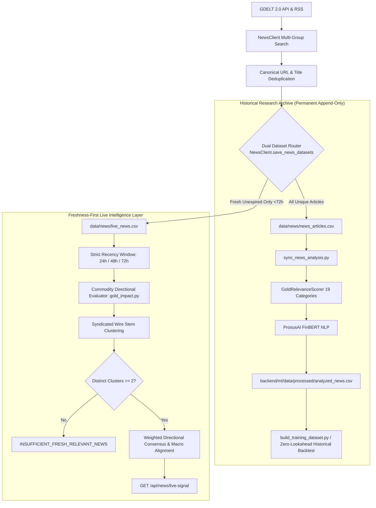

# Financial News Ingestion Pipeline

## 1. Architectural Flow

---

## 2. Ingestion & Provenance

1. **Ingestion Sources**:
   - Primary: **GDELT 2.0 Doc API** (`api.gdeltproject.org`) querying 11 macroeconomic and bullion keyword groups.
   - Fallback: **Google News RSS** with localized Indian financial and bullion coverage if GDELT encounters HTTP 429 throttling.
2. **Dual-Dataset Persistence Architecture**:
   - **Live Production Dataset (`data/news/live_news.csv`)**:
     - Contains strictly unexpired, fresh articles published within the active recency window (collection lookback default: 24h; maximum retention: 72h).
     - Every run automatically prunes stale articles ($> 72\text{h}$) and rejects future-dated articles ($> \text{now} + 15\text{m}$) or invalid timestamps.
     - Enriched with `ingested_at`, `is_gold_relevant`, `driver_category`, `directional_implication`, `confidence`, `evidence_rationale`, `cluster_key`, and `syndicated_copies_count`.
     - Served directly by `GET /api/news/latest` and `GET /api/news/live-signal`.
   - **Historical Research Archive (`data/news/news_articles.csv`)**:
     - Permanent, append-only historical repository preserving all unique articles (2,860+ records) collected across the project's lifetime.
     - Preserves complete data integrity for zero-lookahead training set generation and backtesting. Never pruned or overwritten.
     - Served by `GET /api/news/archive` for historical research access.
3. **Canonical Deduplication**:
   - URL Normalization: Strips marketing tracking parameters (`utm_*`, `oc`, `ref`, `src`, `fbclid`, `gclid`) and trailing slashes.
   - Title Normalization: Strips publisher suffixes (` - Reuters`, ` | Bloomberg`), punctuation, and repeated whitespaces.
   - Result: **0 duplicate URLs and 0 duplicate titles** across all corpus records.
4. **Relevance Tagging**: Classifies whether the article is relevant to precious metals, gold, central banks, or monetary policy (currently 40.0% relevant, 60.0% noise).
5. **Domain-Specific Bullion Direction Mapping & Source Diversity Discounting**:
   - Evaluates commodity-specific economic transmission channels: hawkish Fed / strong USD -> Bearish for gold; dovish pauses, safe-haven geopolitics, central bank buying -> Bullish for gold.
   - **Driver Classification Taxonomy**: Robust multi-pattern classification categorizes headlines into `US_FED_RATES` (rate decisions, holds, tightening), `INFLATION_MACRO` (energy surges, oil spikes, CPI prints), `GEOPOLITICS_SAFE_HAVEN` (military escalation, trade wars, sanctions), `PHYSICAL_AND_CENTRAL_BANK` (sovereign reserves, Diwali/Dhanteras/Karwa Chauth retail demand), `US_DOLLAR_FX`, and `MARKET_MOMENTUM` (strictly genuine chart breakouts and technical rallies). Unmatched commentary defaults cleanly to `OTHER_MACRO`.
   - **Source Diversity Discounting**: Repeated articles from the same media publisher receive diminishing marginal weight ($1/\sqrt{n}$) so multiple wire reprints or commentary from a single outlet cannot overwhelm independent consensus.
   - **Category Saturation Discounting**: Multiple clusters within the identical macro channel receive diminishing returns ($1/\sqrt{k}$) to prevent a single news cycle flood from overwhelming multi-asset breadth.
   - **Cross-Driver Conflict Detection**: When opposing drivers exhibit substantial evidence (both sides $\ge 0.35$ weight) with a narrow spread, net consensus honestly reports `MIXED` rather than forcing a directional bias.
6. **Syndicated Wire Clustering**: Groups wire agency republications (e.g., identical stories published by Reuters, PTI, Yahoo Finance, and regional portals) into distinct semantic clusters, preventing sentiment score inflation.
7. **Strict Separation of Live Operation vs. Historical Evaluation**:
   - **Live Signal**: Operates over a dynamic recency window ($[\text{now} - \text{window}, \text{now}]$, default 24h) and returns `INSUFFICIENT_FRESH_RELEVANT_NEWS` if fewer than 2 distinct clusters exist.
   - **Historical Backtesting**: Merges strictly point-in-time ($published\_at < event\_time$) ensuring zero lookahead leakage.
