# Financial News Ingestion Pipeline

## 1. Architectural Flow

```mermaid
flowchart LR
    GDELT[GDELT 2.0 API & RSS] --> Collector[NewsClient Multi-Group Search]
    Collector --> Dedupe[Canonical URL & Title Deduplication]
    Dedupe --> RawCSV[data/news/news_articles.csv]
    RawCSV --> Sync[sync_news_analysis.py]
    Sync --> Filter[GoldRelevanceScorer 19 Categories]
    Filter --> FinBERT[ProsusAI FinBERT NLP]
    FinBERT --> AnalyzedCSV[ml/data/processed/analyzed_news.csv]
    AnalyzedCSV --> MLMerge[build_training_dataset.py]
```

---

## 2. Ingestion & Provenance

1. **Ingestion Sources**:
   - Primary: **GDELT 2.0 Doc API** (`api.gdeltproject.org`) querying 11 macroeconomic and bullion keyword groups.
   - Fallback: **Google News RSS** with localized Indian financial and bullion coverage if GDELT encounters HTTP 429 throttling.
2. **Corpus Provenance**:
   - Initial Seed Articles: Rows 0–22 (`2026-09-18` to `2026-09-29`), created during repository scaffolding with static canonical URLs.
   - Live Collected Articles: Rows 23–2,814, genuinely collected by scheduled automated workflows (`.github/workflows/news-collector.yml`).
3. **Canonical Deduplication**:
   - URL Normalization: Strips marketing tracking parameters (`utm_*`, `oc`, `ref`, `src`, `fbclid`, `gclid`) and trailing slashes.
   - Title Normalization: Strips publisher suffixes (` - Reuters`, ` | Bloomberg`), punctuation, and repeated whitespaces.
   - Result: **0 duplicate URLs and 0 duplicate titles** across all 2,815 corpus records.
4. **Relevance Tagging**: Classifies whether the article is relevant to precious metals, gold, central banks, or monetary policy (currently 40.0% relevant, 60.0% noise).
5. **Sentiment Processing**: Evaluates text through FinBERT, outputting positive, negative, and neutral confidence probabilities.
6. **Caching & Synchronization**: The persistent cache `analyzed_news.csv` ensures that FinBERT inference is only run once per unique article.
