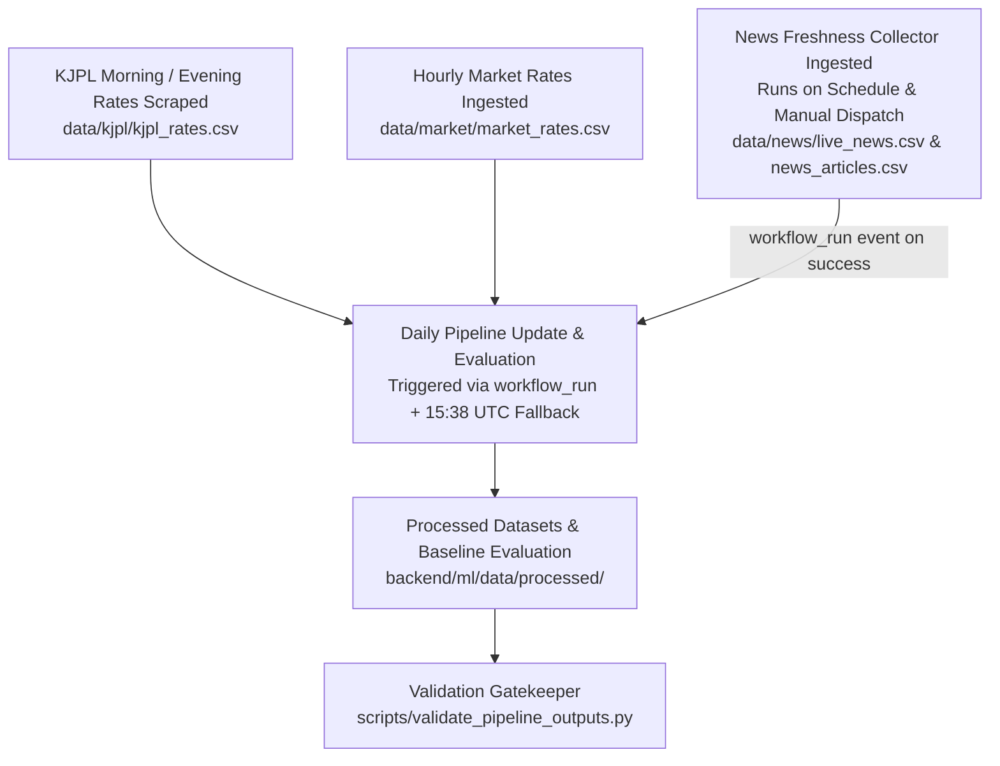

# Scheduled Jobs & Workflow Automation

## 1. Automated GitHub Actions Matrix

| Workflow | File Path | Schedule (UTC) | Schedule (IST) | Purpose |
| :--- | :--- | :--- | :--- | :--- |
| **KJPL Rate Collector** | `.github/workflows/kjpl-collector.yml` | `38 0, 8 1, 38 1, 38 7, 8 8, 38 8 * * *` | ~10:15–11:30 AM & ~5:15–6:30 PM IST | Scrapes KJPL spot gold (`gold_mjdta`) and silver (`silver_mjdta`) rates into `data/kjpl/kjpl_rates.csv`. Pre-shifted for public runner backlog. |
| **Market Data Collector** | `.github/workflows/market-collector.yml` | `0 * * * *` | Hourly (at minute 0) | Ingests `GC=F`, `SI=F`, `USDINR=X` intraday closes from Yahoo Finance into `data/market/market_rates.csv`. Configured in pure UTC without unsupported timezone attributes. |
| **News Freshness Collector** | `.github/workflows/news-collector.yml` | `0 3,9,15,21 * * *` | 8:30 AM, 2:30 PM, 8:30 PM, 2:30 AM IST | Queries GDELT 2.0 with Google News RSS fallback across 11 macro query groups. Writes strictly fresh unexpired news (< 72h retention, 24h collection lookback) to `data/news/live_news.csv` and appends all unique articles permanently into historical research archive `data/news/news_articles.csv`. |
| **Daily Pipeline Update & Evaluation** | `.github/workflows/pipeline-update.yml` | `workflow_run` (after News Data Collector) + `38 15 * * *` fallback | 9:08 PM IST fallback & Event-driven | Triggers automatically on `workflow_run` completion of `News Data Collector` (filtered to `develop` branch and `conclusion == 'success'`). Concurrency controls prevent overlapping runs. Cleans events, builds market features, scores news via FinBERT, rebuilds training matrix, and benchmarks walk-forward evaluation. |

---

## 2. Order of Execution & Dependency Management



### Deterministic Event-Driven Dependency & Concurrency Controls
The Daily Pipeline Update workflow does not rely on wall-clock cron timing alone:
1. **Explicit Workflow Dependency (`workflow_run`)**: Automatically triggers upon the successful completion (`conclusion == 'success'`) of `.github/workflows/news-collector.yml` on branch `develop`.
2. **Upstream Dataset Verification**: An explicit workflow pre-check (`test -s data/...`) confirms that all required upstream datasets (`kjpl_rates.csv`, `market_rates.csv`, `news_articles.csv`) exist and are non-empty before initiating feature generation or training.
3. **Concurrency Control**: Enforces `concurrency: group: pipeline-update-${{ github.ref }}, cancel-in-progress: false` to eliminate race conditions and prevent concurrent Git pushes from producing lost updates or merge conflicts.
4. **Fallback Recovery Schedule**: Maintains a scheduled daily evening run at **15:38 UTC (09:08 PM IST)** to guarantee execution even if an upstream event webhook is delayed or skipped.

### GitHub Actions UTC Constraint
GitHub Actions evaluates all `schedule.cron` triggers strictly in Coordinated Universal Time (UTC). Unsupported attributes such as `timezone: 'Asia/Kolkata'` under `on.schedule` have been eliminated across all workflow definitions to prevent runner syntax warnings. All schedules employ bounded git push retry loops (`MAX_RETRIES=4` with `git pull --rebase origin develop`) to gracefully resolve concurrent commits.

---

## 2. Maintenance & Pipeline Execution

### Automated End-to-End Pipeline
To run the full five-stage data cleaning, feature alignment, news synchronization, training dataset build, and walk-forward evaluation locally:
```bash
cd backend
source .venv/bin/activate
python ml/training/update_pipeline.py
```

### Pipeline Output Validation
To assert integrity across all five generated artifacts:
```bash
cd backend
source .venv/bin/activate
python ../scripts/validate_pipeline_outputs.py
```
Validates:
1. `backend/ml/data/processed/kjpl_events.csv` (Monotonic timestamps, expected columns, zero-lookahead pending event).
2. `backend/ml/data/processed/market_features.csv` (Chronological ordering, return metrics, staleness flags).
3. `backend/ml/data/processed/analyzed_news.csv` (FinBERT probabilities, scores bounded in `[-1.0, 1.0]`, gold relevance taxonomy).
4. `backend/ml/data/processed/gold_training_dataset.csv` (Strict alignment: `len(training_rows) == len(kjpl_events) - 1`, `market_observed_at <= event_time`).
5. `backend/ml/data/processed/evaluation_report.json` (Walk-forward baseline metrics and data readiness threshold).
